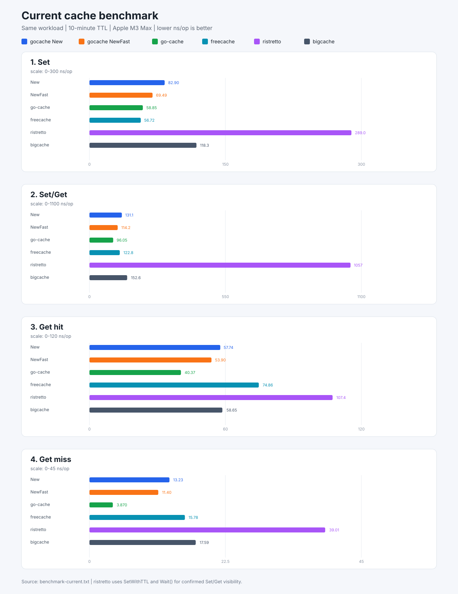

# benchmark-gocache

[](https://pkg.go.dev/github.com/jeffotoni/benchmark-gocache)
[](https://goreportcard.com/report/github.com/jeffotoni/benchmark-gocache)
[](https://github.com/jeffotoni/benchmark-gocache/blob/main/LICENSE)


Reproducible benchmarks for the current `gocache` implementation and selected
Go in-memory cache libraries.

The current comparison is intentionally focused on two `gocache` APIs:

- `New`: the safe default implementation. It preserves the original key and
  keeps different keys isolated even when their hashes collide.
- `NewFast`: the explicit legacy hash-only implementation. It has lower
  overhead, but different keys that produce the same hash can overwrite each
  other.

The historical implementations in `v1` through `v12` are kept for research
and regression comparisons. They are not part of the current comparison and
should not be used to select the current default API.

## Current Implementations

| Implementation | Role |
|----------------|------|
| `gocache-New` | Safe current API, collision-aware storage |
| `gocache-NewFast` | Legacy hash-only API, opt-in performance variant |
| `go-cache` | `patrickmn/go-cache` |
| `freecache` | `coocood/freecache` |
| `ristretto` | `dgraph-io/ristretto` |
| `bigcache` | `allegro/bigcache` |

## Methodology

The current benchmark suite uses the same workload for all implementations:

| Parameter | Value |
|-----------|-------|
| Key count | 4096 hit keys and 4096 miss keys |
| Key pattern | `benchmark:key:<n>` and `benchmark:miss:<n>` |
| Payload | `[]byte("benchmark-value")` |
| Item TTL | 10 minutes |
| Benchmark duration | 3 seconds per sub-benchmark |
| Architecture | Apple M3 Max, Darwin/arm64 |
| Go runtime | Go 1.27.1 in the latest recorded run |
| Parallelism | `GOMAXPROCS=16` in the latest recorded run |

The measured operations are:

- `Set`: insert or replace a value.
- `Set/Get`: write a value and immediately read the same key.
- `Get hit`: read keys populated before the timed section.
- `Get miss`: read keys that were not populated.

All setup work is outside the timed section. `ristretto` is configured with the
same 10-minute TTL through `SetWithTTL`. Because its writes are asynchronous,
`Set/Get` calls `Wait()` before `Get`; this measures confirmed read-after-write
behavior instead of accepting a false miss.

The libraries use their native APIs and storage models. Therefore, the results
are an operational comparison, not a claim that every implementation has
identical internal memory behavior. Always consider correctness, eviction,
TTL semantics and allocation cost together with `ns/op`.

## Latest Results

The following snapshot was generated after aligning the `ristretto` TTL:

```sh
go test -run '^$' -bench '^BenchmarkCurrent' -benchmem -benchtime=3s -count=1
```

Lower `ns/op` is better. `B/op` and `allocs/op` are available in
`benchmark-current.txt`.

| Implementation | Set ns/op | Set/Get ns/op | Get hit ns/op | Get miss ns/op |
|----------------|----------:|--------------:|--------------:|---------------:|
| gocache New | 82.90 | 131.1 | 57.74 | 13.23 |
| gocache NewFast | 69.49 | 114.2 | 53.90 | 11.40 |
| go-cache | 58.85 | 96.05 | 40.37 | 3.870 |
| freecache | 56.72 | 122.8 | 74.86 | 15.78 |
| ristretto | 289.0 | 1057 | 107.4 | 39.01 |
| bigcache | 118.3 | 152.6 | 58.65 | 17.59 |



### Interpretation

- `NewFast` is faster than safe `New`, but it must only be used when the
  caller accepts the hash-collision trade-off.
- `go-cache` and `freecache` have the lowest `Set` latency in this run.
- `go-cache` has the lowest `Get hit` and `Get miss` latency in this run.
- `New` remains competitive with `bigcache` and `ristretto` for reads while
  preserving exact key isolation.
- `ristretto` is much slower in `Set/Get` because the benchmark waits for its
  asynchronous write to become observable before reading.

These numbers are machine-, Go-version- and workload-dependent. They are a
snapshot, not a universal ranking.

## Reproduce

Run the current suite:

```sh
go test -run '^$' -bench '^BenchmarkCurrent' -benchmem -benchtime=3s -count=1
```

Save a raw result file:

```sh
go test -run '^$' -bench '^BenchmarkCurrent' -benchmem -benchtime=3s -count=1 \
  | tee benchmark-current.txt
```

Repeat the run to observe variance:

```sh
go test -run '^$' -bench '^BenchmarkCurrent' -benchmem -benchtime=3s -count=5
```

If `benchstat` is installed, compare repeated runs with:

```sh
go test -run '^$' -bench '^BenchmarkCurrent' -benchmem -benchtime=3s -count=5 \
  > benchmark-current-count5.txt
benchstat benchmark-current-count5.txt
```

Run the full test suite, including the historical packages:

```sh
go test ./...
```

The `Makefile` provides shortcuts for the current benchmark and test suite.

## Repository Layout

| Path | Purpose |
|------|---------|
| `benchmark_current_test.go` | Canonical current comparison |
| `benchmark-current.txt` | Latest raw benchmark snapshot |
| `benchmark_test.go` | Historical and exploratory benchmarks |
| `v1` through `v12` | Historical implementation copies |
| `Makefile` | Reproduction commands |

The current benchmark imports the local `gocache` checkout through the
development `replace` directive in `go.mod`. This keeps the benchmark pointed
at the exact local source being evaluated. For a clean external checkout,
replace it with a published `gocache` version before running the benchmark.

## Contributing

Contributions are welcome, especially new benchmark implementations and
reproducible workload improvements.

1. Fork this repository and create a focused branch.
2. Add the implementation to `benchmark_current_test.go` only when it follows
   the same key, payload, TTL and validation rules as the current suite.
3. Keep experimental or historical versions outside the current comparison.
4. Run `go test ./...` and at least one complete `BenchmarkCurrent` execution.
5. Include the machine, Go version, command and raw output in the pull request.

Do not interpret a single benchmark run as a universal ranking. Changes to
payload shape, TTL, cache capacity, asynchronous write handling or key
distribution must be documented because they can change the result materially.

## Related Project: gocache

[github.com/jeffotoni/gocache](https://github.com/jeffotoni/gocache) is the
source project for the implementations measured here.

It contains:

- The safe `New` API, which is the recommended default and preserves exact key
  isolation when hashes collide.
- The explicit `NewFast` API, which keeps the legacy hash-only behavior for
  callers that prioritize lower overhead and accept collision risk.
- Typed cache constructors, capacity limits, statistics and expiration
  handling.
- API documentation, tests and the current benchmark comparison graph.

The benchmark repository measures behavior; the related project owns the cache
implementation and its public API. When the implementation changes, update
the local `replace` target or the published module version before collecting a
new benchmark snapshot.

## License

This project is released under the MIT License.
